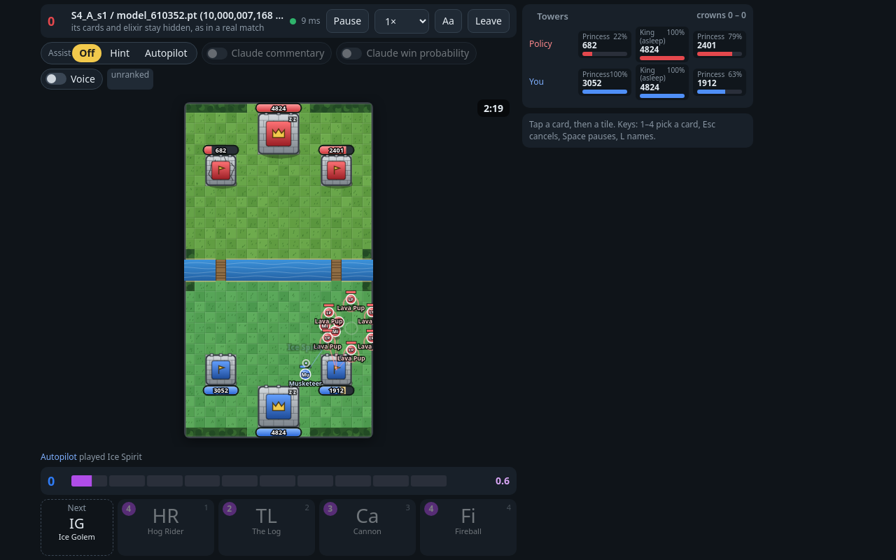
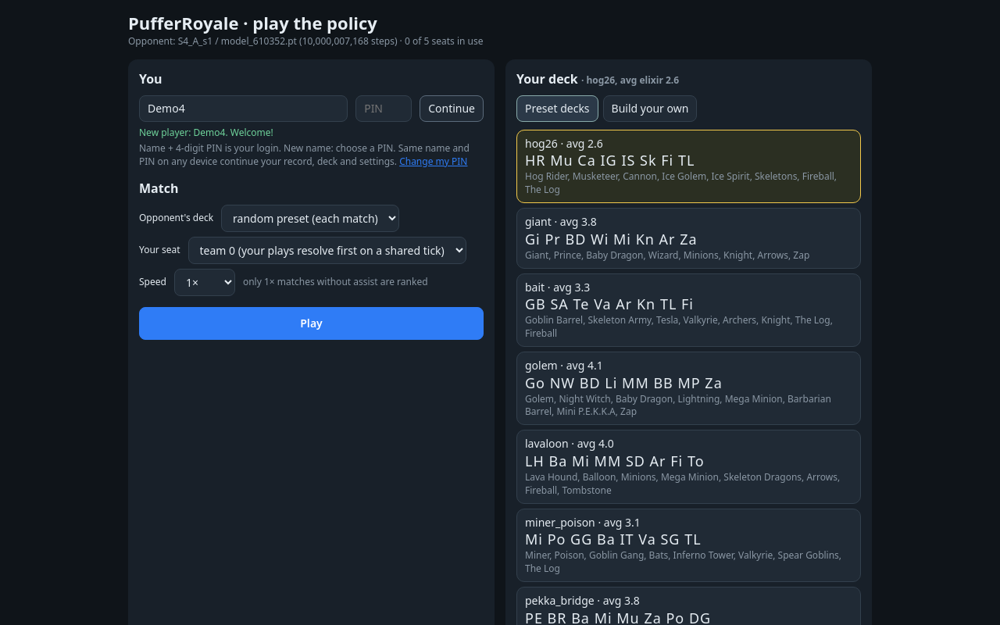
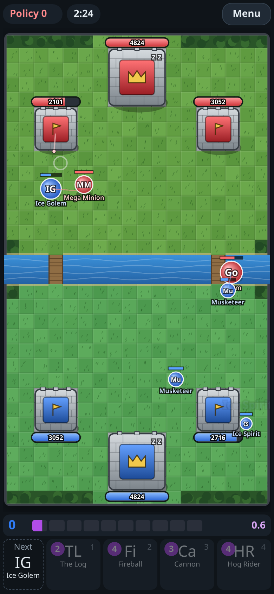
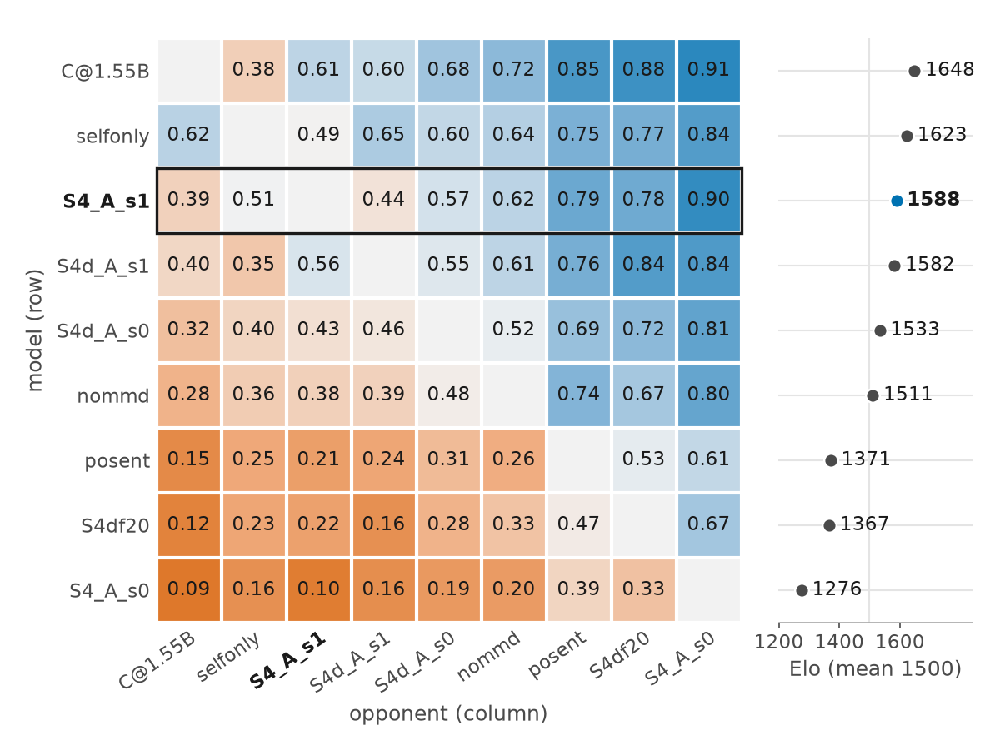
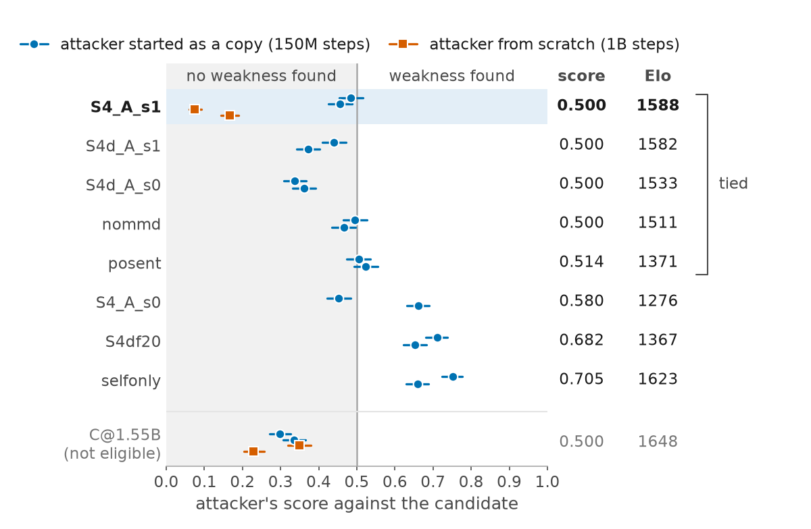
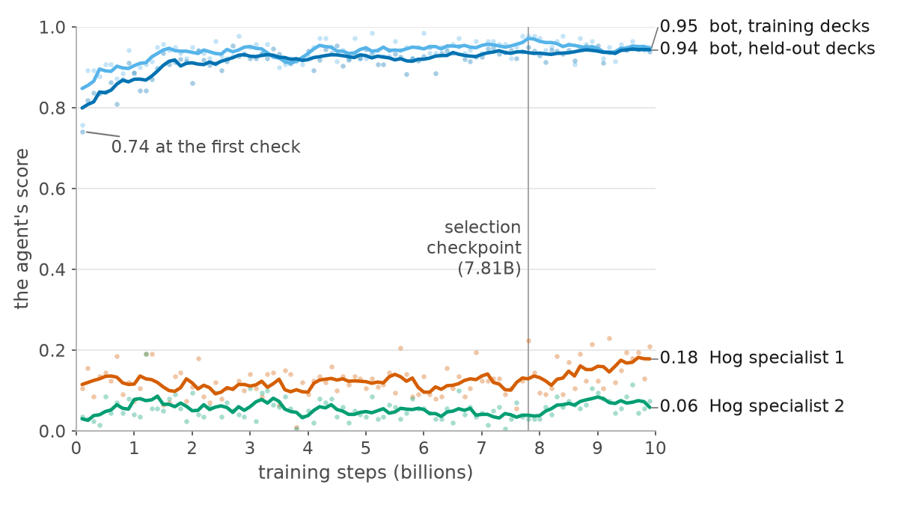
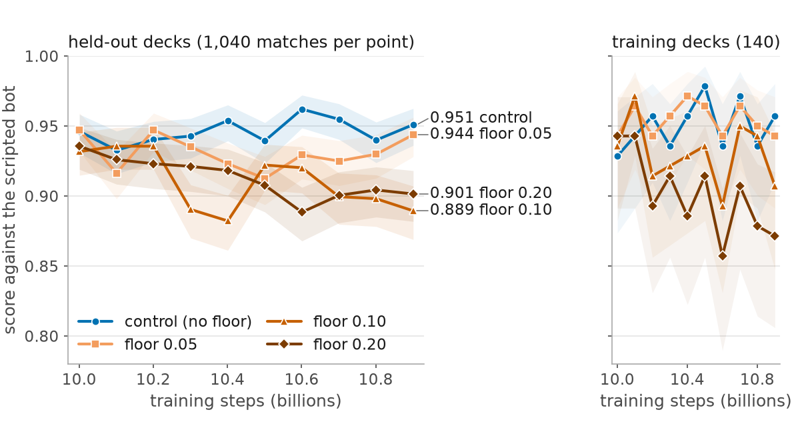
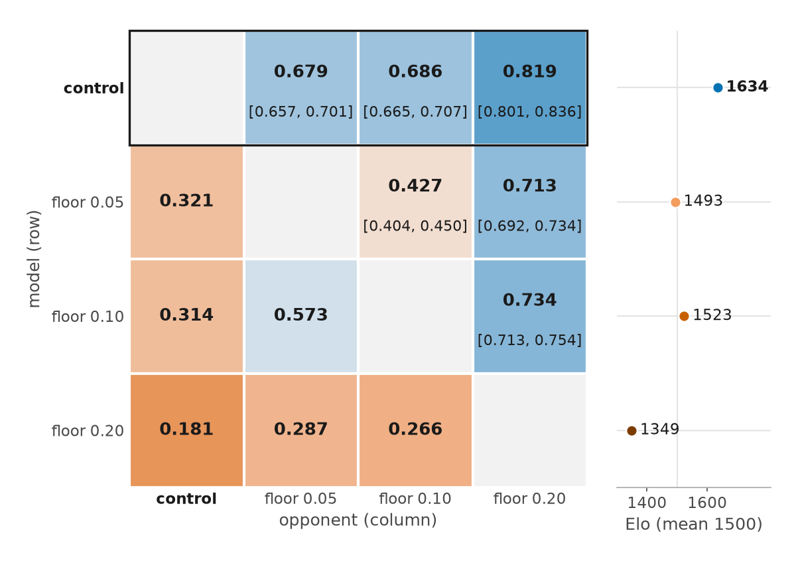
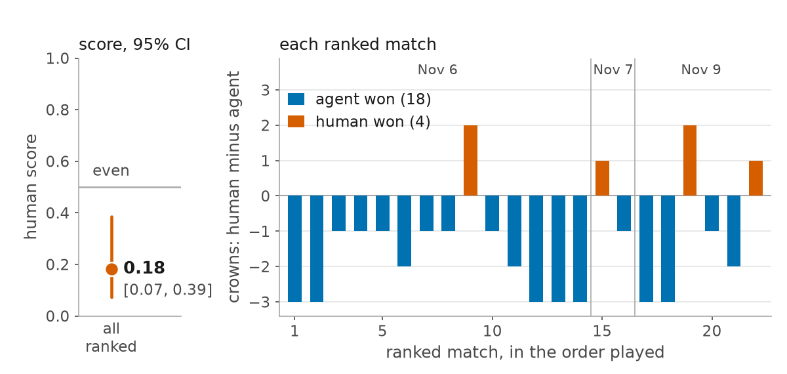
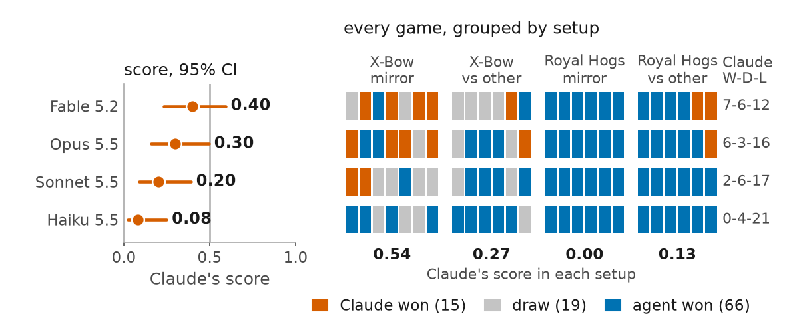

# PufferRoyale

PufferRoyale is three things: an exact, fast simulator of 1v1 Clash Royale-style battles, an agent that learned
the game by playing against itself for 10 billion steps, and a website where you can play against that agent.

**[▶ Play against the agent](https://aditya-gupta26.github.io/pr-play/)** ·
[The model](models/README.md) · [Research](#research) · [Advisor for the real game](#the-advisor-for-the-real-game) ·
[Docs](docs/README.md)



> **This is an unofficial research project.** PufferRoyale is non-commercial and is **not affiliated with,
> endorsed, sponsored or approved by Supercell** (see Supercell's
> [Fan Content Policy](https://supercell.com/en/fan-content-policy/)). The card statistics belong to Supercell
> and are used only as measurements. The website uses no game art: units and towers are drawn with shapes,
> letters and generic emoji. One part of this repository, the advisor in [`advisor/`](advisor/), reads the
> screen of the real game, which Supercell's Terms of Service forbid. Please read
> [its warning](#the-advisor-for-the-real-game) before you use it.

## Contents

1. [How to play](#how-to-play)
2. [The advisor for the real game](#the-advisor-for-the-real-game)
3. [The released model](#the-released-model)
4. [Research](#research): the simulator, the agent, training, evaluation, results, compute and limitations
5. [Build, test and reproduce](#build-test-and-reproduce)
6. [Repository layout](#repository-layout)
7. [Citing, licence and acknowledgements](#citing-licence-and-acknowledgements)

---

## How to play

### In your browser (nothing to install)

Open **https://aditya-gupta26.github.io/pr-play/** on a computer or a phone, then:

1. **Sign in** with a name. The same name brings back your record, deck and settings on any device, and a device
   you have signed in on remembers you next time. There is no password, so anyone who types your name plays as you.
2. **Pick a deck.** Choose one of the 7 presets or build your own from the 64 cards. You can choose the agent's
   deck too, or leave it on "random preset".
3. **Play.** Press **Play** and drag a card onto your half of the arena (or tap a card, then a tile). Your card
   goes in at the next engine tick, within 50 ms. The bar under the arena is your elixir, and every card shows
   its cost. On a keyboard, `1` to `4` pick a card, `Esc` cancels and `Space` pauses.

The rules are those of a 1v1 ladder battle. A match lasts 3 minutes. Each Princess tower you destroy is worth one
crown, and the King tower is worth all three. If the crowns are level after 3 minutes, you play 2 minutes of
sudden-death overtime, and if it is still level after that, the HP of each side's weakest tower decides. Elixir
starts at 6 and caps at 10. It comes twice as fast from the last minute of regulation on, and three times as fast
in the last minute of overtime.

**Who you are up against.** The agent makes a decision every 0.5 s, using only what a player could see: it never
sees your hand or your elixir, and you never see its. So far humans have won **4 of 22 ranked matches** against
it ([details](#humans)). On the site, the agent has to play a card once it has sat on full elixir for 5 seconds
(see [Limitations](#limitations)).

The page has a few extras. *Hint* marks the card and tile the agent itself would play in your place, and
*Autopilot* lets it play for you (any card you play still goes first). A match with either one switched on is not
ranked; the leaderboard only counts finished matches played at 1× speed without help. Every match is recorded and
can be replayed exactly, because the engine is deterministic, and you can watch other people's matches live. A
separate panel shows the 100 games that four Claude models played against the agent ([results](#language-models)),
each with its replay.

The server runs on a CPU node of a university cluster and moves to a new node every two days. If the page says it
is restarting, just wait: it keeps retrying by itself.

| Lobby | On a phone |
|---|---|
|  |  |

### On your own computer

You need Linux or macOS, a C compiler and Python 3.10 or newer. First install
[PufferLib 3.0 from source](docs/DEVELOPING.md#install-and-build); it needs a one-line fix, which that link shows.
Then:

```bash
git clone https://github.com/Aditya-Gupta26/PufferRoyale.git && cd PufferRoyale
pip install -e '.[train]'        # numpy, gymnasium, torch (+ PufferLib, installed above)
make build                       # compiles the C engine into pufferroyale/binding*.so
python play/play_server.py       # prints http://localhost:8765/?token=...  -> open it
```

By default the server plays the model in [`models/`](models/README.md), and `--checkpoint` picks another one.
[`docs/HUMAN_PLAY.md`](docs/HUMAN_PLAY.md) describes the full site as it runs on the cluster. If you would rather
watch a match in the terminal:

```bash
python scripts/watch.py --checkpoint models/S4_A_s1_10B.pt --p1 heuristic   # the agent vs the scripted bot
```

---

## The advisor for the real game

> [!WARNING]
> **Please read this before using it.** The advisor reads the screen of the real Clash Royale game. Supercell's
> Terms of Service (effective 2024-11-06) prohibit "automation software, emulators, bots, hacks, mods or any
> unauthorized third-party software designed to modify or interfere with the Service", and getting information
> "using any method not expressly permitted". A screen-reading advisor is third-party software that reads the
> game, so **using it can get your account banned**. It is published as research. If you try it anyway, use it
> only outside ranked play (Training Camp, or a friendly battle with a friend who agrees), on an account you are
> prepared to lose, and never against people who do not know.

The advisor watches the game picture (a phone mirrored with `scrcpy`, or the PC client) and rebuilds from it the
exact 17,715-number observation the agent was trained on. It then asks the agent what it would do and shows the
suggested card, tile and probability in a separate window. It **never taps or sends any input to the game**: you
decide, and you play.

```
frame --perception--> units, hand, elixir, towers --tracker--> board state --encoder--> observation --policy--> suggestion
```

We measured how well this works inside the simulator, where the true state is known. The encoding step is exact:
409,566 states from 600 simulated matches gave exactly the engine's own observation, with no mismatches. What
costs the agent its edge is imperfect seeing and delay. To show this, the agent played through the advisor
against itself playing on the engine's own observation, so a score of 0.5 means nothing was lost:

| What the advisor works with | Score against the agent that sees the true state |
|---|---|
| Perfect perception | **0.501** (1,000 matches) |
| The measured detector errors | **0.250** |
| The detector errors plus 0.5 s of delay | **0.190** |

[`docs/ADVISOR.md`](docs/ADVISOR.md) covers the setup, its checks and every known gap. The unit detector comes from
[ClashRoyaleBuildABot](https://github.com/Pbatch/ClashRoyaleBuildABot) (MIT, although the model's metadata names
AGPL-3.0) and is downloaded separately; this repository contains no detector weights.

---

## The released model

[`models/S4_A_s1_10B.pt`](models/README.md) is the agent you play on the website. Its run is called `S4_A_s1`.

| | |
|---|---|
| Run | `S4_A_s1`: pure self-play PPO, seed 1, all 64 cards |
| Training | 10,000,007,168 steps, 23.9 million self-play matches, 188.7 h on one NVIDIA A100 |
| Size | 1,287,556 parameters (5.2 MB), feed-forward, card-first action head |
| Against the scripted heuristic bot | **0.939** [0.923, 0.952] on 52 held-out decks (1,040 matches, at 9.9B steps) |
| Exploitability | 4 trained attackers found no exploit (measured at 7.81B steps; [details](#exploitability)) |
| Against humans | humans won 4 and lost 18 ranked matches |

The [model card](models/README.md) explains how to load it and lists its full training settings, its intended use
and its limits.

---

## Research

### In short

The question behind this project is easy to state. Can a small agent learn a real-time card battle game, where
each player sees only part of what is going on, purely by playing against itself? And if it can, how
*exploitable* is the result, that is, how badly can an attacker trained specifically against it beat it?

To answer it we built an exact, fast simulator (C99, integers only, 64 cards), a PPO agent that first picks a card
and then a tile, a toolkit for league training and evaluation (round robins, Elo ratings, meta-game Nash
mixtures and best-response exploitability), and a model-selection procedure whose rules were written down before
any result came in. Here is what we found:

1. At small scale (1B steps on one deck), every training method ended up **easy to exploit**. Attackers scored
   0.85 to 0.87 against them, and no method was clearly better than the others.
2. With all 64 cards and 10B steps, **league training with MMD collapsed in all 4 runs**. Pure self-play never
   collapsed.
3. The selected pure self-play agent beats the scripted bot about **94%** of the time on decks it never trained
   with. Trained attackers found no exploit, although a stronger attacker might, since an attack only ever gives
   a lower bound.
4. **Forcing the agent to keep playing every card made it worse.** In two separate experiments, the version
   without this "card floor" beat every floored version head to head (scoring 0.61 to 0.82 against them) and was
   also the hardest to exploit.
5. Humans won 4 of their 22 ranked matches against the final agent.
6. Four Claude models (Fable 5.2, Opus 5.5, Sonnet 5.5 and Haiku 5.5) scored between **0.08 and 0.40** against it
   over 100 games. Most of Claude's wins came when both sides played X-Bow.

### The simulator

| | |
|---|---|
| Engine | Header-only C99 with an **integer-only** state (millitiles, milliseconds, an exact integer square root). The same seed and the same actions always give a bit-identical state. A snapshot is one `memcpy`, and every state has an FNV-1a hash. |
| Clock | 20 ticks per second. The agent acts every 10 ticks (0.5 s). Regulation is 3,600 ticks, and overtime adds 2,400. |
| Content | **64 cards** at tournament level 11, with stats from the 15.535.29 client as decoded by [RoyaleSim](https://github.com/RoyaleGym/RoyaleSim), and 4 tower troops |
| Observation | 17,715 floats: 25 board planes (32 × 18 tiles), 64 entity slots, 306 scalars and the legality mask. The opponent's hand, elixir and unseen deck are never included, and a test checks this. |
| Actions | `Discrete(2305)`: wait, or one of 4 hand slots × 576 tiles. The mask is the engine's own legality check. |
| Speed | About 500,000 engine ticks/s and 25,000 environment steps/s on one Apple M4 core |
| Checks | C unit tests and fuzzing (167,993 checks in this release's run, 0 failures), a 1,000-match fuzz test that rotates the board by 180° (0 divergences), and an independent black-box test suite written from the spec |

The full specification is in [`docs/SPEC.md`](docs/SPEC.md). Every choice the spec leaves open, and every known
difference from the real game, is listed in [`docs/FIDELITY.md`](docs/FIDELITY.md).

### The agent

The agent is a feed-forward network with **1,287,556 parameters** (`pufferroyale/torch.py`). Three encoders read
the observation. A CNN turns the 25 board planes into 256 values, a shared MLP reads every entity slot and pools
them per side (masked mean and max, 4 × 128 values), and a third MLP reads the scalars and the 17 card ids (128
values). Each card id becomes a learned 16-dimensional embedding plus a 16-dimensional projection of 24 engine
statistics such as cost, HP, damage, range and speed. That way the agent has a sense of what a card does even if
it has rarely played it.

The action head is *card-first*. The agent first decides whether to play at all and which card, $P(\text{wait})$
and $P(s)$ for the 4 hand slots, and only then where, $P(\text{tile}\mid s)$. The tile comes from a
full-resolution board CNN that is modulated by the chosen card (FiLM). Together,
$\log P(s) + \log P(\text{tile}\mid s)$ form one 2,305-way categorical distribution, so to PPO it looks like an
ordinary discrete action.

### Training

Training uses PPO from [PufferLib 3.0](https://github.com/PufferAI/PufferLib) (`PuffeRL`) with 256 parallel learner
rows, batch 16,384, minibatch 1,024, learning rate 3e-4, γ = 0.999, λ = 0.95 and an entropy coefficient of 0.01.

We compared three ways of choosing the opponent:

| Method | Who the agent plays against |
|---|---|
| **A**, pure self-play | its current self |
| **B**, league | its current self 35% of the time, and past snapshots of itself 65% of the time. Snapshots are chosen by prioritised fictitious self-play (PFSP) with weight $(1-p)^2$, where $p$ is the agent's score against that snapshot, so the snapshots it struggles with come up more often. |
| **C**, league + MMD | the same as B, plus a magnetic mirror descent (MMD) regulariser |

The MMD regulariser adds a pull towards a reference policy that is refreshed every so often:
$\mathcal{L} = \mathcal{L}_\text{PPO} + \alpha\,\mathrm{KL}(\pi_\theta \,\|\, \pi_\text{ref})$.

A win is worth +1, a loss -1 and a draw 0. Early in training we add potential-based shaping from tower HP, crowns
and wasted elixir, and anneal it to 0 over the first 0.5B steps. Because the shaping is potential-based, it does not
change which policy is optimal, and evaluation never uses it.

Each seat gets a random 8-card deck half of the time and one of the 7 training decks (the presets) otherwise.
52 decks (X-Bow, Royal Hogs and 50 random ones) are **held out**: the agent never trains with them, and we keep
them for evaluation.

For one ablation we also add a **card floor**, a minimum probability for every playable card:
$P'(s) = (1 - k\varepsilon)\,P(s) + \varepsilon$ for the $k$ playable cards. The floor only applies during
training; evaluation and the website play without it.

<details>
<summary><b>Where each piece is implemented</b></summary>

| Piece | File |
|---|---|
| Engine (rules, combat, pathing, spells, the tick pipeline) | `pufferroyale/csrc/*.h` |
| PufferLib environment, observation layout | `pufferroyale/royale.py`, `pufferroyale/csrc/royale.h`, `pufferroyale/csrc/pr_obs.h` |
| Policy (encoders, card-first head, card floor) | `pufferroyale/torch.py` |
| League: opponent pool, PFSP, snapshots | `pufferroyale/league.py`, `scripts/league_train.py` |
| MMD regulariser | `pufferroyale/trainer.py` (`MMDPuffeRL`) |
| Reward shaping and annealing, deck sampling | `pufferroyale/csrc/royale.h`, `scripts/league_train.py` |
| Best-response exploitability probe | `scripts/best_response.py` |
| Round robin, Elo (Bradley-Terry), meta-game Nash (LP) | `pufferroyale/metagame.py`, `scripts/tournament.py`, `hpc/stage4_eval.py` |
| Evaluation vs scripted bots (Wilson intervals) | `scripts/eval.py`, `hpc/eval_watch.py` |
| Cluster jobs (Slurm + Apptainer) | `hpc/` |
| Play site | `play/` |
| Advisor | `advisor/` |
| Text interface for language models | `pufferroyale/llm.py`, `scripts/llm_match.py`, `hpc/llm_game.py` |

</details>

### How models were evaluated

We used three kinds of test.

**Scripted bots.** The agent plays a `noop` bot, a `random` bot and a rule-based `heuristic` bot from both seats.
Its score is (wins + draws/2) / matches, with a 95% Wilson interval, and training decks and held-out decks are
reported separately.

**Best-response exploitability.** A fresh learner, the attacker, trains against one frozen target and then plays
it 1,000 times. The target's exploitability is the attacker's score, $\text{br\_score} = (W + D/2)/1000$, so
anything above 0.5 means the attacker found a way to win. We used two kinds of attacker. A *copy-start* attacker
begins as a copy of the target and trains for 150M steps; a *from-scratch* attacker trains for 1B steps. Either
way the result is a lower bound, because a stronger attacker might do better.

**Round robins.** Every pair of models plays 200 matches in each of 9 preset deck mirrors, 1,800 matches per
pair. From the results we get a payoff matrix, Elo ratings (fitted with Bradley-Terry, one number per model,
higher is stronger) and the Nash mixture of the meta-game, which is the blend of models that is hardest to beat.

### Results

Every number below comes from [`docs/STAGE4_SELECTION.md`](docs/STAGE4_SELECTION.md) and
[`docs/EXPERIMENTS.md`](docs/EXPERIMENTS.md), where each run is logged with its job id, commit and command.

#### 1. Training methods at small scale

Stage 3 tested the three methods on one deck for 1B steps, with 3 seeds each. Every method's final policy turned
out to be easy to exploit: the attackers' mean score was 0.874 against A, 0.847 against B and 0.863 against C. The
spread between seeds (up to 0.32) was bigger than the gaps between the methods, so none of them was clearly
better.

#### 2. The full game

Stage 4 moved to all 64 cards and 10B steps. All four league + MMD runs (method C) **collapsed** somewhere between
1.65B and 2.9B steps: first the choice of tile became deterministic, then the set of cards the agent played
narrowed. No pure self-play run collapsed. A one-seed ablation suggests that the collapse needs MMD *and* snapshot
opponents together.

#### 3. Choosing the model

We wrote the selection rules down before seeing any results: first a round robin, then an exploitability test,
then a winner.

In the round robin of the 9 candidates, C@1.55B came out on top with an Elo of 1648, followed by S4x_selfonly
(1623) and S4_A_s1 (1588). No candidate beat all the others.



*Each of the 9 candidates played every other one 1,800 times, in mirrors of the 9 preset decks. A cell is the row
model's score against the column model (the 95% interval is about ±0.023), rows are sorted by Elo, and the Elo
ratings are on the right. Even the top-rated C@1.55B scores only 0.38 against selfonly. The hardest mix of these
models to beat (the Nash mixture) is about half S4_A_s1 (0.51) and half selfonly (0.47).*

<a id="exploitability"></a>Next, two copy-start attackers went after each candidate. S4_A_s1 held up, with
attacker scores of 0.4845 and 0.4565, while two candidates were exploited by both of their attackers (0.65 to
0.75).



*Each marker is one attacker, trained against a frozen candidate and then played against it 1,000 times on random
decks, with its 95% interval. Above 0.5 the attacker found a weakness, so lower is better. Blue circles started as a
copy of the candidate (150M steps); orange squares trained from scratch (1B steps). A copy starts at 0.5, so a
score below 0.5 means it found nothing and drifted. The score column is the mean of a candidate's two copy-start
attackers, each counted as at least 0.5. The five candidates within 0.05 of the best tied, and the highest Elo
broke the tie.*

**S4_A_s1 (pure self-play, seed 1) won the selection** and became the released agent. Two from-scratch attackers,
trained for 1B steps each, then scored only 0.0745 and 0.166 against it.

One caveat, to be honest about it: many copy-start attackers ended *below* 0.5, which should not happen to an exact
copy of the target. The selection therefore read every score below 0.5 as 0.5, meaning no exploit found. We adopted
that reading after the scores were in. Taken literally, the original rule would have picked S4d_A_s0 instead. The
log keeps both readings.

#### 4. The selected agent

These are the released agent's numbers, at the step closest to 10B that has an evaluation.



*Every 0.1B steps the agent played the scripted bot on its 7 training decks and on the 52 held-out decks it never
trained with. Dots are single evaluations and lines average 5 neighbouring ones; the score is (wins + ½ draws) /
matches. The two low lines are agents trained only on the Hog deck, met in a Hog mirror: on their own deck they
still beat the generalist easily. Against the random bot the agent scored at least 0.992 every time (not drawn).*

| Opponent | Score | Matches |
|---|---|---|
| Heuristic bot, 52 held-out decks | 0.939 [0.923, 0.952] | 1,040 (at 9.9B) |
| Heuristic bot, 7 training decks | 0.950 [0.900, 0.976] | 140 (at 9.9B) |
| Heuristic bot, pre-registered check at 5B | 0.912 training / 0.906 held-out | 1,008 / 1,040 |
| Random bot, training / held-out decks | 1.000 / 0.998 | 140 / 1,040 (at 9.9B) |
| One-deck specialists from stage 3, in their own Hog mirror | 0.210 and 0.075 | 200 each (at 9.9B) |

The 64-card generalist is strong overall, but it still **loses clearly to agents that trained on a single deck**
when it meets them on that deck.

#### 5. Does forcing card diversity help?

Here we asked whether a card floor (see [Training](#training)) makes the agent better. We tried it in two families.
In the first, four copies of the agent at 10.0B each trained for 1.0B more steps: a **control** with no floor, and
copies with floors of 0.05, 0.10 and 0.20. In the second, the same three floors were trained from scratch to 2.5B
steps and compared with the agent's own run at 2.5B, which plays the control's part there.

Against the scripted bot on held-out decks, floors 0.10 and 0.20 fell below the control, while floor 0.05 stayed
within noise of it.



*The four copies against the scripted bot, checked every 0.1B steps and played without the floor; bands are 95%
intervals. Over the last three checks on held-out decks (left, 1,040 matches per point), the intervals of floors
0.10 and 0.20 sit below the control's, while floor 0.05 overlaps it at least once. On the training decks (right,
140 matches per point) every interval overlaps the control's.*

Head to head, over 1,800 matches per pair, the control beat every floored copy and made up the whole Nash mixture:



*The four copies at 11.0B steps played each other 1,800 times per pair in 9 deck mirrors. A cell is the row model's
score against the column model, with its 95% interval shown once per pair; Elo is on the right.*

| Row's score against column | control | floor 0.05 | floor 0.10 | floor 0.20 | Elo |
|---|---|---|---|---|---|
| control | · | **0.679** | **0.686** | **0.819** | 1634 |
| floor 0.05 | 0.321 | · | 0.427 | 0.713 | 1493 |
| floor 0.10 | 0.314 | 0.573 | · | 0.734 | 1523 |
| floor 0.20 | 0.181 | 0.287 | 0.266 | · | 1349 |

The deciding test was exploitability, with two attackers per model. The control was the hardest to exploit in both
families:

| Mean attacker score (above 0.5 means exploited) | control | floor 0.05 | floor 0.10 | floor 0.20 |
|---|---|---|---|---|
| Continued from the 10B agent (+1.0B steps) | **0.45** | 0.65 | 0.51 | 0.70 |
| Trained from scratch (2.5B steps) | **0.49** | 0.65 | 0.69 | 0.71 |

None of the attackers found an exploit against either control, and in the from-scratch family the control also
beat each floored run head to head (0.61 to 0.63). In both families, then, a constant floor of 0.05 to 0.20 never
helped. The released model is still the 10B agent; the control at 11.0B has not been compared with it directly.

#### 6. <a id="humans"></a>Humans

Four players played 22 ranked matches between 6 and 9 November 2026. Humans won 4 and lost 18, with no draws, a
human score of **0.18** [0.07, 0.39]. The agent won 9 of its 18 by destroying the King Tower. Two players played 18
of the 22, so the matches are not fully independent, and 16 of the 22 were played before a fix that removed up to
0.5 s of input delay for humans. Another 8 matches were not ranked (5 abandoned, 3 with hints on) and are not
counted.



*Left: the human score over all 22 ranked matches, with its 95% interval (which treats the matches as
independent). Right: every ranked match in the order played, as human crowns minus agent crowns; -3 means the
agent destroyed the King Tower without losing a tower.*

#### 7. <a id="language-models"></a>Language models

Four Claude models played the agent 25 times each through the text interface (`pufferroyale/llm.py`, run by
`hpc/llm_game.py`). Every model got the same 25 games: game *k* has the same seed, decks and side for all four.
Claude played X-Bow or Royal Hogs, and the agent played either the same deck (a mirror) or one of its training
decks.

Claude reads a text description of the board and answers once per game second. The game waits for each answer, so
thinking time is free, while the agent acts every half second. All calls went through the Claude Code CLI with
effort `low`. A game that ends with equal crowns counts as a draw; we ignore the engine's tower-HP tiebreak.



*Left: Claude's score per model, (wins + ½ draws) / games, with its 95% interval. Right: all 100 games, one square
each, grouped by setup, with each model's record at the end of its row and Claude's score in each setup
underneath.*

| Claude model | Games | Claude W-D-L | Claude's score [95% CI] |
|---|---|---|---|
| Fable 5.2 | 25 | 7-6-12 | **0.40** [0.23, 0.59] |
| Opus 5.5 | 25 | 6-3-16 | 0.30 [0.16, 0.50] |
| Sonnet 5.5 | 25 | 2-6-17 | 0.20 [0.09, 0.39] |
| Haiku 5.5 | 25 | 0-4-21 | 0.08 [0.02, 0.25] |
| All four | 100 | 15-19-66 | 0.245 [0.17, 0.34] |

The agent outscored every model. Fable 5.2 came closest, and Haiku 5.5 never won a game. The deck mattered more
than the model: in X-Bow mirrors Claude scored 0.54 and won 10 of its 15 games, while in Royal Hogs mirrors it lost
all 24. Claude's wins were also narrow, every one of them 1-0. A good example is game 24 for Opus 5.5, which saw an
enemy tower sitting at 70 HP and reasoned that "Earthquake deals 3 × 49 = 147 to crown towers, so it finishes the
tower". It did, and that single tower won the game.

The per-game results are in [`docs/figures/claude_games.json`](docs/figures/claude_games.json), and the log with
job ids is in [`docs/STAGE4_SELECTION.md`](docs/STAGE4_SELECTION.md). The play site shows the same results, with a
replay of every game, under "Games against language models".

### Compute

All training ran on NYU's Torch cluster, one GPU per job (A100 80GB, H100 80GB or H200). The released model alone
took 188.7 GPU-hours on one A100, at about 14,800 steps per second.

The logged items add up to about **560 GPU-hours**: setup and calibration (4.6), stage 1 (20.7), throughput work
(6.0), stage 3 (200.2), the stage-3 attacker calibration (10.3), the released model (188.7), the stage-3b attackers
(55.8) and stage 4a (70.4). The true total is higher, because several runs have no logged total: the stage-2 and
stage-3 attacker probes (estimated at about 60 and 56 to 110 GPU-hours), most stage-4 runs and stage 4b. Per-job
GPU-hours are in [`docs/EXPERIMENTS.md`](docs/EXPERIMENTS.md).

### Limitations

- **The simulator has not been checked against real matches.** The engine follows RoyaleSim's measured ledger, but
  we never compared it with recordings of real games. It models 64 of the roughly 123 regular cards, with no
  Evolutions, Champions or Heroes. All cards are level 11, the agent trained with Princess towers only, and the
  arena is the 2018 map. [`docs/FIDELITY.md`](docs/FIDELITY.md) has the full list.
- **Exploitability is only a lower bound**, and it was measured on the 7.81B checkpoint rather than the released
  10B one. Attacker scores did not always rise with the attacker's budget, and many copy-start attackers drifted
  below 0.5 for reasons we have not established.
- **One selection rule was settled after seeing results** (see result 3). Several ablations have a single seed, and
  the winner's configuration with seed 0 ranked last of 9 by Elo, so seeds matter.
- **Training is not bit-reproducible on GPU**, because it uses non-deterministic cuDNN, which is about 45× faster.
  The engine itself is deterministic.
- **The human sample is small** (22 ranked matches), and most of those matches had an input-delay handicap.
- **The language-model games** used one prompt, effort `low` and two decks for Claude. With 25 games per model the
  intervals are wide, and those of Opus 5.5 and Sonnet 5.5 overlap.
- **The scripted heuristic bot** was used while tuning hyperparameters, so it is not a fully unseen benchmark.
- **The agent can go passive.** It never trained against an opponent that stops playing, and against one it often
  sits on full elixir. In 14 test games against an opponent that never plays, it won 11, drew 3 at 0 to 0 and
  wasted about 50 elixir per game. Since 17 November 2026 the play site removes the agent's wait option after
  5 seconds on full elixir, so it plays the card it already preferred. With that rule it won all 14 games by
  destroying the King tower and wasted about 1.5 elixir per game, and in 14 games against the agent without the
  rule it won 6, drew 5 and lost 3. The rule is a patch on the site; the model itself is unchanged.

---

## Build, test and reproduce

```bash
make build && make test-c                       # engine + C unit tests (and `make asan` under sanitizers)
python -m pytest tests -q                       # builder + independent spec test suites
python -m pytest hpc/tests advisor/tests -q     # cluster tools and advisor
```

To retrain the released model, use the settings below. On the cluster they ran through `hpc/league.sbatch` as 13
chained jobs of 20 h each on one A100:

```bash
RUN_ID=S4_A_s1 SEED=1 ANCHORS=none SELF_PLAY_FRAC=1.0 ANCHOR_FRAC=0 PFSP=hard MMD_COEF=0 \
TOTAL=10000000000 NUM_ENVS=256 BATCH_SIZE=16384 MINIBATCH_SIZE=1024 SNAPSHOT_INTERVAL=477 MAX_SNAPSHOTS=64 \
EXTRA_ARGS="--train.torch-deterministic= --env.reward-tower 0.3 --env.reward-crown 0.2 --env.reward-elixir 0.01 \
  --train.reward-clip 0 --shaping-anneal-frac 0.05 --env-threads 16 --fast-opponents --cuda-graphs \
  --env.deck-pool hog26;giant;bait;golem;lavaloon;miner_poison;pekka_bridge --env.random-deck-frac 0.5 \
  --env.heldout-decks xbow;royal_hogs;random:50:20261003 --env.deck-draw independent \
  --card-floor 0.005 --card-floor-steps 5000000000" \
sbatch hpc/league.sbatch
```

The run's full configuration is in [`models/S4_A_s1_10B/config.json`](models/S4_A_s1_10B/config.json).
[`docs/DEVELOPING.md`](docs/DEVELOPING.md) covers every command-line tool (train, evaluate, watch, league, best
response, tournament, LLM matches) and the Python API. For the cluster, see
[`docs/HPC_HANDOFF.md`](docs/HPC_HANDOFF.md) and [`hpc/README.md`](hpc/README.md). The figures are rebuilt from the
run outputs by [`docs/figures/make_figures.py`](docs/figures/make_figures.py).

---

## Repository layout

```
pufferroyale/   the simulator: C engine (csrc/), Python bindings, PufferLib env, policy, league, metagame, LLM text interface
models/         the released agent (S4_A_s1_10B.pt), its run config and model card
play/           the browser game: server, page, cluster job, permanent link, voice worker
advisor/        the advisor for the real game: perception, tracker, encoder, policy, overlay, app (+ its tests and jobs)
scripts/        command-line tools: train, league_train, eval, watch, best_response, tournament, llm_match, ...
hpc/            NYU Torch cluster: Apptainer image, Slurm templates, stage and Claude-game tools
tests/          C tests, builder tests, the independent spec tests, golden hashes
tools/          card and arena table generators, raylib download
data/source/    pinned inputs from RoyaleSim (with provenance and licence)
docs/           specification, fidelity notes, decisions, experiment logs, guides, figures (index: docs/README.md)
```

---

## Citing, licence and acknowledgements

If you use PufferRoyale, please cite it ([`CITATION.cff`](CITATION.cff)):

```bibtex
@software{gupta2026pufferroyale,
  author = {Gupta, Aditya},
  title  = {PufferRoyale: a deterministic 1v1 Clash Royale-style battle simulator and league self-play agents},
  year   = {2026},
  url    = {https://github.com/Aditya-Gupta26/PufferRoyale}
}
```

The code and the released model are under the MIT licence ([`LICENSE`](LICENSE)). Two pieces come from elsewhere:
`pufferroyale/env_binding.h` is from PufferLib (MIT, `pufferroyale/PUFFERLIB_LICENSE`), and the card and arena data
come from RoyaleSim (MIT, `data/source/ROYALESIM_LICENSE`), although the card numbers themselves are Supercell's.

This project is built on [PufferLib](https://github.com/PufferAI/PufferLib) and
[RoyaleSim](https://github.com/RoyaleGym/RoyaleSim). The advisor uses
[ClashRoyaleBuildABot](https://github.com/Pbatch/ClashRoyaleBuildABot)'s detector, and KataCR's
[Clash Royale detection dataset](https://github.com/wty-yy/Clash-Royale-Detection-Dataset) for its accuracy check.
Training ran on NYU's Torch cluster.

PufferRoyale is **not affiliated with Supercell**. Clash Royale is a trademark of Supercell.
