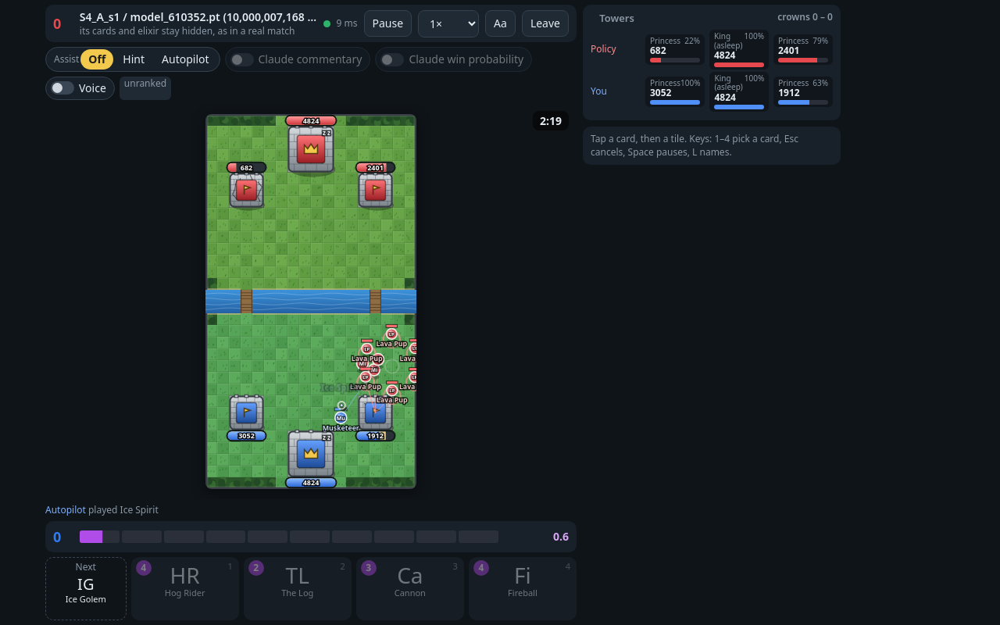
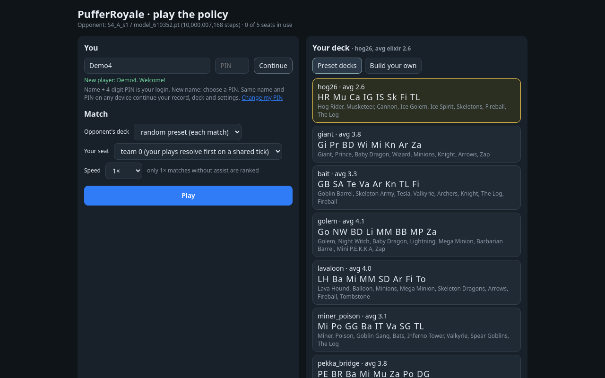
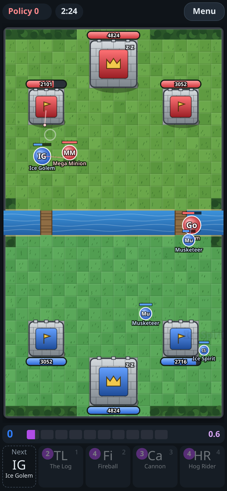
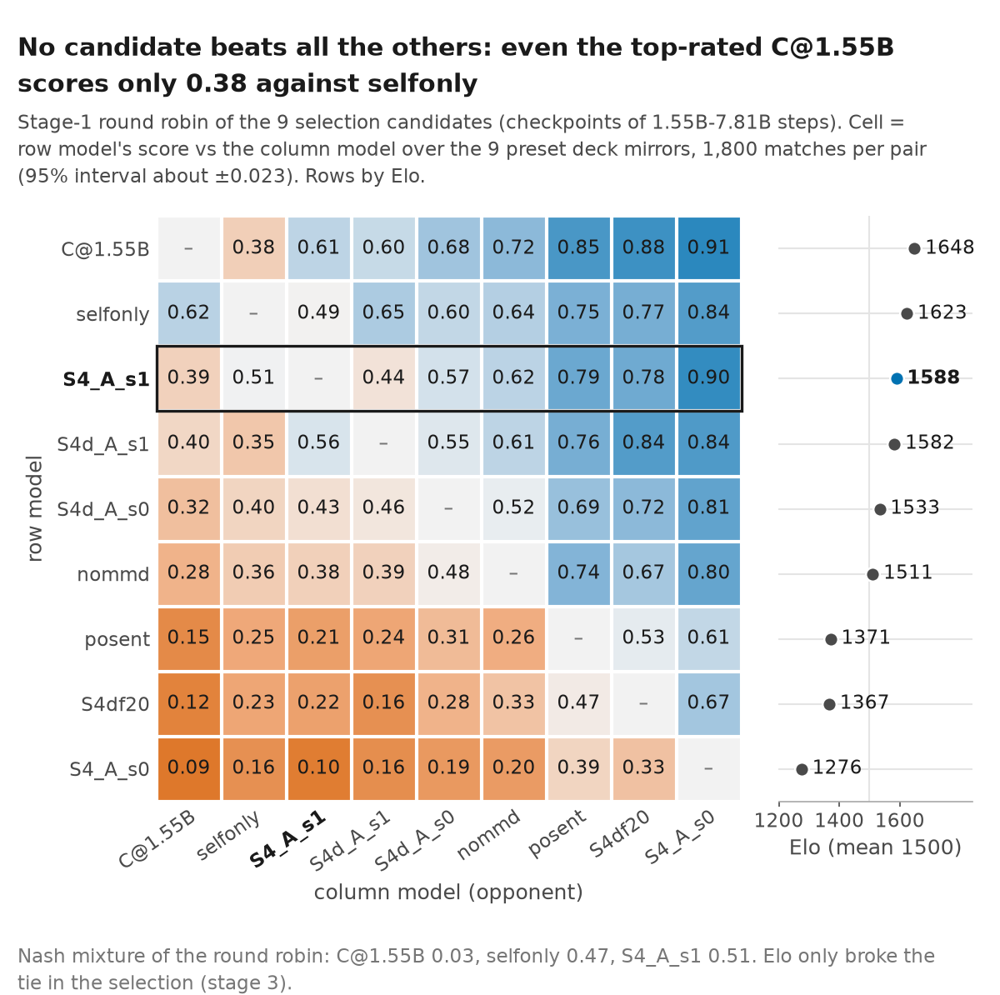
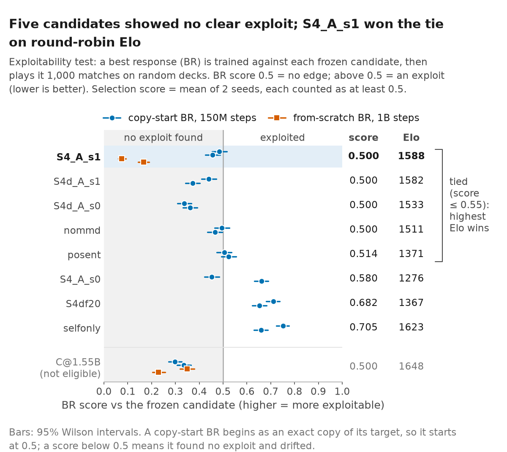
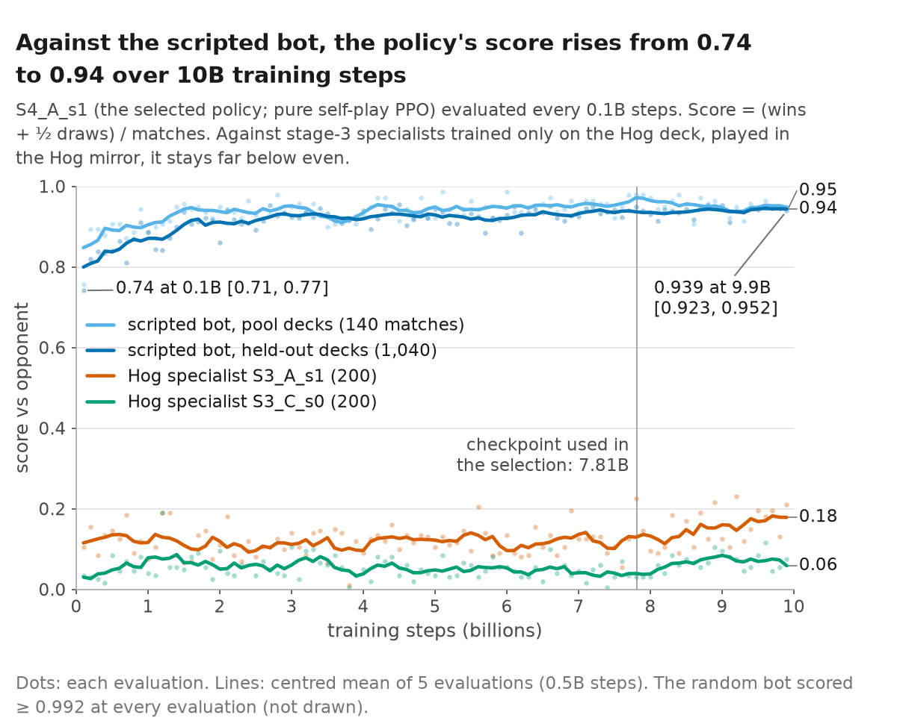
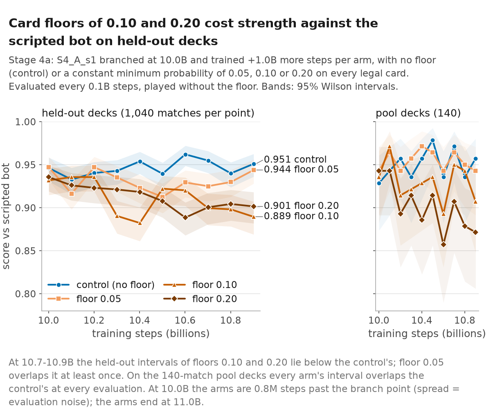
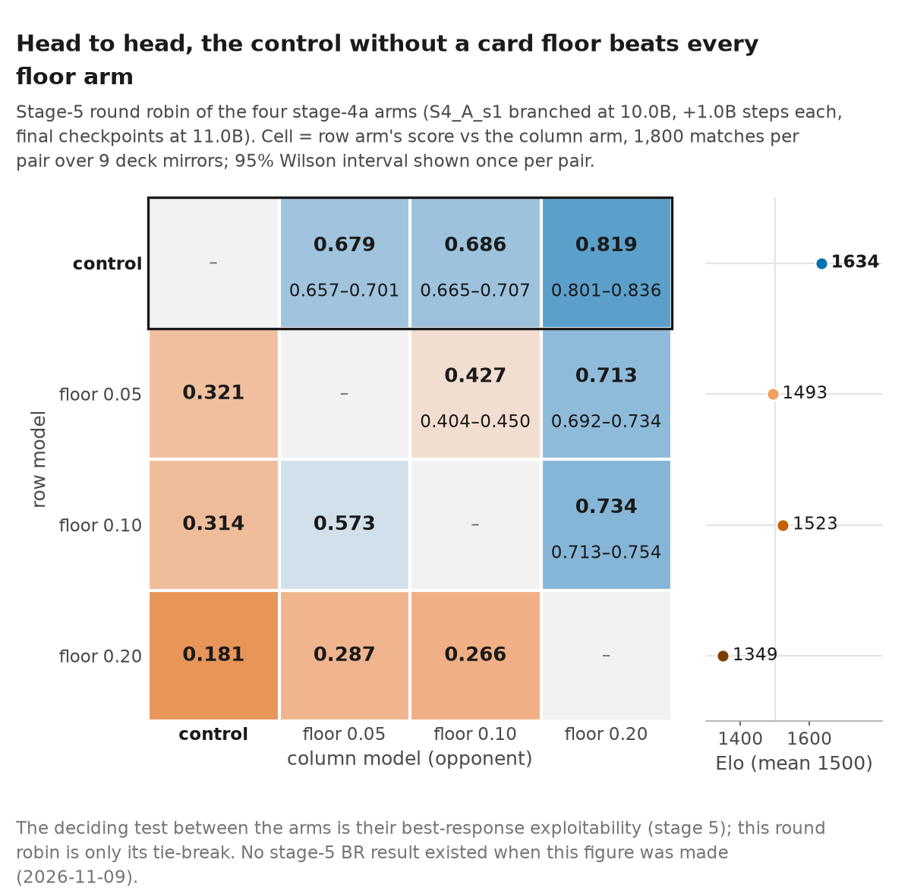
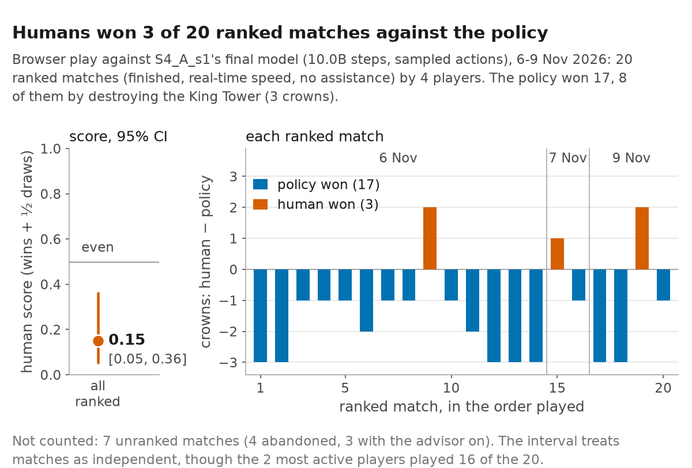

# PufferRoyale

**A deterministic simulator of 1v1 Clash Royale-style battles, an agent trained on it by self-play for
10 billion steps, and a website where anyone can play against that agent.**

**[▶ Play against the agent](https://aditya-gupta26.github.io/pr-play/)** ·
[The model](models/README.md) · [Research](#research) · [Advisor for the real game](#the-advisor-for-the-real-game) ·
[Docs](docs/README.md)



> **Unofficial research project.** PufferRoyale is non-commercial and is **not affiliated with, endorsed,
> sponsored or approved by Supercell** (see Supercell's
> [Fan Content Policy](https://supercell.com/en/fan-content-policy/)). The card statistics are Supercell's and
> are used as measurement input only. The website uses no game art: units and towers are drawn with shapes,
> letters and generic emoji. The advisor in [`advisor/`](advisor/) reads the screen of the real game, which
> Supercell's Terms of Service forbid; read [its warning](#the-advisor-for-the-real-game) before using it.

## Contents

1. [How to play](#how-to-play)
2. [The advisor for the real game](#the-advisor-for-the-real-game)
3. [The released model](#the-released-model)
4. [Research](#research): the simulator, the method, how it is implemented, results, compute, limitations
5. [Build, test and reproduce](#build-test-and-reproduce)
6. [Repository layout](#repository-layout)
7. [Citing, licence and acknowledgements](#citing-licence-and-acknowledgements)

---

## How to play

### In your browser (nothing to install)

Open **https://aditya-gupta26.github.io/pr-play/** on a computer or a phone.

1. **Sign in.** Type a name and choose a 4-digit PIN. Next time, on any device, the same name and PIN bring back
   your record, deck and settings.
2. **Choose decks.** Pick one of the 7 preset decks or build your own from the 64 cards. Pick the agent's deck
   too, or leave it on "random preset".
3. **Play.** Press **Play**, then drag a card onto your half of the arena (or tap a card, then a tile).
   - Your card goes in at the next engine tick, within 50 ms.
   - The bar under the arena is your elixir; each card shows its cost.
   - Keys: `1`-`4` pick a card, `Esc` cancels, `Space` pauses.
4. **Win.** The rules of a 1v1 ladder battle:
   - 3 minutes; each destroyed Princess tower is 1 crown, the King tower is all 3;
   - if crowns are level, 2 minutes of sudden-death overtime, then the weakest tower's HP decides;
   - elixir starts at 6, caps at 10, and comes 2× as fast from the last minute of regulation and 3× in the
     last minute of overtime.

**What you face.** The agent decides every 0.5 s from what a player could see. It never sees your hand or your
elixir, and you never see its. So far humans won **3 of 20 ranked matches** against it (details in
[results](#humans)).

**Extras on the page:**

- **Assist:** *Hint* marks the agent's own pick for your side; *Autopilot* lets it play for you (any card you
  play goes first). A match with assist is not ranked.
- **Leaderboard:** counts finished matches at 1× speed with assist off.
- **Watch:** every match is recorded and replayed exactly, because the engine is deterministic. Live matches
  can be spectated.

**Availability.** The server runs on a CPU node of a university cluster and moves to a new node every two days.
If the page says it is restarting, it keeps retrying by itself.

| Lobby | On a phone |
|---|---|
|  |  |

### On your own computer

You need Linux or macOS, a C compiler and Python 3.10 or newer. Install
[PufferLib 3.0 from source](docs/DEVELOPING.md#install-and-build) first (a one-line fix is needed; the link
shows it). Then:

```bash
git clone https://github.com/Aditya-Gupta26/PufferRoyale.git && cd PufferRoyale
pip install -e '.[train]'        # numpy, gymnasium, torch (+ PufferLib, installed above)
make build                       # compiles the C engine into pufferroyale/binding*.so
python play/play_server.py       # prints http://localhost:8765/?token=...  -> open it
```

The server plays the model in [`models/`](models/README.md) by default (`--checkpoint` picks another). The full
site, as it runs on the cluster, is described in [`docs/HUMAN_PLAY.md`](docs/HUMAN_PLAY.md).

To watch a match in the terminal instead:

```bash
python scripts/watch.py --checkpoint models/S4_A_s1_10B.pt --p1 heuristic   # the agent vs the scripted bot
```

---

## The advisor for the real game

> [!WARNING]
> **Read this before using it.** The advisor reads the screen of the real Clash Royale game. Supercell's Terms
> of Service (effective 2024-11-06) prohibit "automation software, emulators, bots, hacks, mods or any
> unauthorized third-party software designed to modify or interfere with the Service", and getting information
> "using any method not expressly permitted". A screen-reading advisor is third-party software reading the
> game, so **using it can get your account banned**. It is published as research. If you try it, use it only
> outside ranked play (Training Camp, or a friendly battle with a friend who agrees), on an account you accept
> the risk for. Never use it against people who do not know.

**What it does.** It reads the game picture (a phone mirrored with `scrcpy`, or the PC client) and rebuilds the
agent's exact 17,715-number observation. It then runs the agent and shows its suggested card, tile and
probability in a separate window. It **never taps or sends input to the game**; you decide and play.

```
frame --perception--> units, hand, elixir, towers --tracker--> board state --encoder--> observation --policy--> suggestion
```

**How well it works** (all measured in the simulator, where the truth is known):

- **The encoder is exact.** 409,566 states from 600 simulated matches encode to exactly the engine's own
  observation (0 mismatches).
- **Imperfect seeing and latency cost most of the agent's edge.** The agent playing through the advisor scores
  against itself playing on the engine's own observation (0.5 = no loss):
  - perfect perception: **0.501** (1,000 matches);
  - with the measured detector errors: **0.250**;
  - with errors plus 0.5 s delay: **0.190**.

Setup, its checks and every known gap: [`docs/ADVISOR.md`](docs/ADVISOR.md). Its unit detector comes from
[ClashRoyaleBuildABot](https://github.com/Pbatch/ClashRoyaleBuildABot) (MIT; the model's metadata names
AGPL-3.0) and is downloaded separately; this repository contains no detector weights.

---

## The released model

[`models/S4_A_s1_10B.pt`](models/README.md): the agent on the website.

| | |
|---|---|
| Run | `S4_A_s1`: pure self-play PPO, seed 1, all 64 cards |
| Training | 10,000,007,168 steps; 23.9 million self-play matches; 188.7 h on one NVIDIA A100 |
| Size | 1,287,556 parameters (5.2 MB), feed-forward, card-first action head |
| vs the scripted heuristic bot | **0.939** [0.923, 0.952] on 52 held-out decks (1,040 matches, at 9.9B steps) |
| Exploitability | no exploit found by 4 trained attackers (measured at 7.81B steps; [details](#exploitability)) |
| vs humans | humans 3 wins, 17 losses in ranked matches |

How to load it, its full training settings, its intended use and its limits are in the
[model card](models/README.md).

---

## Research

### In short

- **Question:** can a small agent learn a real-time, partially observed card battle game from self-play alone,
  and how exploitable does it end up? Exploitability means how badly a purpose-trained attacker can beat it.
- **What we built:**
  - an exact, fast simulator (C99, integers only, 64 cards);
  - a PPO agent with a card-first action head;
  - a league training and evaluation toolkit: round robins, Elo, meta-game Nash, best-response exploitability;
  - a pre-registered model-selection pipeline.
- **What we found:**
  1. At 1B steps on one deck, every method's final policy was **easy to exploit** (best-response score
     0.85-0.87). No method was clearly better.
  2. With all 64 cards and 10B steps, **league + MMD training collapsed in all 4 runs**. Pure self-play never
     collapsed.
  3. The selected pure self-play agent beats the scripted bot about **94%** of the time on decks it never trained
     with. Trained attackers did not find an exploit, but a stronger attacker might (a best response gives only
     a lower bound).
  4. **Forcing card diversity during training made the agent weaker.** A floor on each card's probability lost
     head-to-head to the unfloored control: 0.68 to 0.82 for the control.
  5. Humans won 3 of 20 ranked matches against the final agent.

### The simulator

| | |
|---|---|
| Engine | header-only C99, **integer-only** state (millitiles, milliseconds, exact integer square root); same seed + same actions ⇒ bit-identical state; snapshot/restore is `memcpy`; FNV-1a state hash |
| Clock | 20 ticks/s; the agent acts every 10 ticks (0.5 s); regulation 3,600 ticks + 2,400 overtime |
| Content | **64 cards** at tournament level 11, stats from the 15.535.29 client as decoded by [RoyaleSim](https://github.com/RoyaleGym/RoyaleSim); 4 tower troops |
| Observation | 17,715 floats: 25 board planes (32 × 18 tiles), 64 entity slots, 306 scalars, the legality mask. The opponent's hand, elixir and unseen deck are never included (tested) |
| Actions | `Discrete(2305)`: wait, or one of 4 hand slots × 576 tiles; the mask is the engine's own legality check |
| Speed | ~500,000 engine ticks/s and ~25,000 env steps/s on one Apple M4 core |
| Checks | C unit tests and fuzzing (167,993 checks in this release's run, 0 failures); a 1,000-match 180° rotation fuzz with 0 divergences; an independent black-box spec test suite |

Specification: [`docs/SPEC.md`](docs/SPEC.md). Every choice the spec leaves open, and every known difference
from the real game: [`docs/FIDELITY.md`](docs/FIDELITY.md).

### The agent

A feed-forward network with **1,287,556 parameters** (`pufferroyale/torch.py`):

- **Encoders:**
  - a CNN over the 25 board planes → 256 values;
  - a shared MLP over entity slots with masked mean and max pooling per side → 4 × 128;
  - an MLP over the scalars and 17 card ids → 128.
  - Each card id is encoded as a learned 16-d embedding plus a 16-d projection of 24 engine statistics (cost,
    HP, damage, range, speed, ...). So the agent "knows" what a card does even when it has rarely played it.
- **Card-first head.** The agent first picks *whether* to play and *which* card,
  $P(\text{wait})$ and $P(s)$ for the 4 hand slots. Then it picks *where*, $P(\text{tile}\mid s)$, from a
  full-resolution board CNN modulated per card (FiLM). The joint log-probability
  $\log P(s) + \log P(\text{tile}\mid s)$ is one 2,305-way categorical, so PPO sees an ordinary discrete action.

### Training

- **PPO** with [PufferLib 3.0](https://github.com/PufferAI/PufferLib) (`PuffeRL`), 256 parallel learner rows,
  batch 16,384, minibatch 1,024, learning rate 3e-4, γ = 0.999, λ = 0.95, entropy 0.01.
- **Opponents (three methods compared):**
  - **A**, pure self-play;
  - **B**, a league: 35% self-play and 65% past snapshots chosen by prioritised fictitious self-play (PFSP), with
    weight $(1-p)^2$ where $p$ is the learner's score against that snapshot;
  - **C**, B plus an **MMD** (magnetic mirror descent) regulariser, $\mathcal{L} = \mathcal{L}_\text{PPO} +
    \alpha\,\mathrm{KL}(\pi_\theta \,\|\, \pi_\text{ref})$ with a periodically refreshed reference policy.
- **Reward:** win +1, loss −1, draw 0, plus potential-based shaping from tower HP, crowns and wasted elixir. The
  shaping is annealed to 0 over the first 0.5B steps. The potential form keeps the optimal policy unchanged;
  evaluation never uses it.
- **Decks:** each seat gets a random 8-card deck half of the time and one of 7 preset decks otherwise. 52 decks
  (X-Bow, Royal Hogs and 50 random ones) are **held out** for evaluation.
- **Card-probability floor (ablation):** $P'(s) = (1 - k\varepsilon)\,P(s) + \varepsilon$ for the $k$ playable
  cards. It is used only in training; evaluation and the website play without it.

<details>
<summary><b>Where each piece is implemented</b></summary>

| Piece | File |
|---|---|
| Engine (rules, combat, pathing, spells, the tick pipeline) | `pufferroyale/csrc/*.h` |
| PufferLib environment, observation layout | `pufferroyale/royale.py`, `pufferroyale/csrc/royale.h`, `pufferroyale/csrc/pr_obs.h` |
| Policy (encoders, card-first head, card floor) | `pufferroyale/torch.py` |
| League: opponent pool, PFSP, snapshots | `pufferroyale/league.py`, `scripts/league_train.py` |
| MMD regulariser | `pufferroyale/trainer.py` (`MMDPuffeRL`) |
| Reward shaping and annealing, deck sampling | `pufferroyale/csrc/royale.h`, `scripts/league_train.py` |
| Best-response exploitability probe | `scripts/best_response.py` |
| Round robin, Elo (Bradley-Terry), meta-game Nash (LP) | `pufferroyale/metagame.py`, `scripts/tournament.py`, `hpc/stage4_eval.py` |
| Evaluation vs scripted bots (Wilson intervals) | `scripts/eval.py`, `hpc/eval_watch.py` |
| Cluster jobs (Slurm + Apptainer) | `hpc/` |
| Play site | `play/` |
| Advisor | `advisor/` |
| Text interface for language models | `pufferroyale/llm.py`, `scripts/llm_match.py`, `hpc/llm_game.py` |

</details>

### How models were evaluated

- **Against scripted bots** (`noop`, `random`, a rule-based `heuristic`): score = (wins + draws/2) / matches,
  both seats, with Wilson 95% intervals. Pool decks and held-out decks are reported separately.
- **Best-response exploitability.** A fresh learner trains against one frozen target, then plays 1,000 matches
  against it. The target's exploitability is measured by $\text{br\_score} = (W + D/2)/1000$; above 0.5 means
  the attacker found a way to win. Two kinds of attacker were used:
  - *copy-start*, which begins as a copy of the target (150M steps);
  - *from-scratch* (1B steps).

  This only gives a lower bound: a stronger attacker might do better.
- **Round robins.** 9 preset decks × 200 matches per pair (1,800 matches) give a payoff matrix, Elo ratings
  (Bradley-Terry) and the Nash equilibrium of the meta-game, i.e. which mix of models is hardest to beat.

### Results

All numbers below come from [`docs/STAGE4_SELECTION.md`](docs/STAGE4_SELECTION.md) and
[`docs/EXPERIMENTS.md`](docs/EXPERIMENTS.md), where every run is logged with its job id, commit and command.

**1. Methods at small scale (stage 3: one deck, 1B steps, 3 seeds).** Every method's final policy was easy to
exploit. The mean best-response score was A 0.874, B 0.847, C 0.863, and the spread between seeds (up to 0.32)
was larger than the gaps between methods.

**2. Full game (stage 4: 64 cards, 10B steps).**
- All four league + MMD (C) runs **collapsed** between 1.65B and 2.9B steps: tile choice became deterministic,
  then the set of cards played narrowed.
- No pure self-play run collapsed.
- A one-seed ablation suggests the collapse needs MMD *and* snapshot opponents together.

**3. Model selection.** The rules were written before any result: round robin → exploitability → winner.

- **Round robin of 9 candidates.** Elo leader C@1.55B 1648, then S4x_selfonly 1623 and S4_A_s1 1588. No
  candidate beats all the others.



- **<a id="exploitability"></a>Exploitability**, 2 copy-start attackers per candidate:
  - S4_A_s1 scored 0.4845 and 0.4565;
  - two candidates were exploited in both seeds (0.65-0.75).



- **Winner: S4_A_s1** (pure self-play, seed 1). Two from-scratch 1B-step attackers then scored only 0.0745 and
  0.166 against it.
- **Caveat:** many copy-start attackers ended *below* 0.5, which should not happen to a copy. So the selection
  read every score below 0.5 as 0.5 (no exploit found). That reading was adopted after the scores were seen;
  taken literally, the original rule would have picked S4d_A_s0. Both readings are in the log.

**4. The selected agent** (the released model; numbers at the step closest to 10B that has an evaluation):



| Opponent | Score | Matches |
|---|---|---|
| Heuristic bot, 52 held-out decks | 0.939 [0.923, 0.952] | 1,040 (at 9.9B) |
| Heuristic bot, 7 pool decks | 0.950 [0.900, 0.976] | 140 (at 9.9B) |
| Heuristic bot, pre-registered check at 5B | 0.912 pool / 0.906 held-out | 1,008 / 1,040 |
| Random bot, pool / held-out decks | 1.000 / 0.998 | 140 / 1,040 (at 9.9B) |
| One-deck specialists from stage 3, in their own Hog mirror | 0.210 and 0.075 | 200 each (at 9.9B) |

The 64-card generalist still **loses clearly to agents that trained on only one deck**, on that deck.

**5. Does forcing card diversity help? (stage 4/5 ablation).**
- Four copies of the agent at 10.0B trained 1.0B more steps each:
  - the **control** with no floor;
  - copies with card floors 0.05, 0.10 and 0.20.
- Against the scripted bot on held-out decks, floors 0.10 and 0.20 fall below the control; floor 0.05 stays
  within noise of it.
- **Head to head, the control beats every floored copy** (1,800 matches per pair) and is the whole Nash mixture.


- **Not decided yet:** the deciding exploitability test (8 attackers) is still queued, and a second family
  (the same floors trained from scratch to 2.5B) is still training.



| row beats column | control | floor 0.05 | floor 0.10 | floor 0.20 | Elo |
|---|---|---|---|---|---|
| control | – | **0.679** | **0.686** | **0.819** | 1634 |
| floor 0.05 | 0.321 | – | 0.427 | 0.713 | 1493 |
| floor 0.10 | 0.314 | 0.573 | – | 0.734 | 1523 |
| floor 0.20 | 0.181 | 0.287 | 0.266 | – | 1349 |

**6. <a id="humans"></a>Humans.**
- 20 ranked matches from 4 players, 2026-11-06 to 11-09: humans won 3 and lost 17, a human score of **0.15**
  [0.05, 0.36]. Two players played 16 of the 20, so the matches are not fully independent.
- 16 of the 20 were played before a fix that removed up to 0.5 s of input delay for humans.



**7. Language models.** Claude models have played earlier agents of this project through the text interface
(`pufferroyale/llm.py`); games against this agent are planned. Results will be added here.

### Compute

All training ran on NYU's Torch cluster, one GPU per job (A100 80GB, H100 80GB, H200).

- **The released model:** 188.7 GPU-hours on one A100 (about 14,800 steps/s).
- **Logged items:** setup and calibration (4.6), stage 1 (20.7), throughput work (6.0), stage 3 (200.2), the
  stage-3 attacker calibration (10.3), the released model (188.7), the stage-3b attackers (55.8) and stage 4a
  (70.4) sum to about **560 GPU-hours**.
- **Unlogged runs:** the stage-2 and stage-3 attacker probes (estimated at about 60 and 56-110 GPU-hours),
  most stage-4 runs and stage 4b have no logged total, so the true total is higher.

Per-job GPU-hours are in [`docs/EXPERIMENTS.md`](docs/EXPERIMENTS.md).

### Limitations

- **Not checked against real matches.** The engine follows RoyaleSim's measured ledger, but no comparison with
  recordings of real matches was done. 64 of about 123 regular cards are modelled, with no Evolutions,
  Champions or Heroes. All cards are level 11, the agent trained with Princess towers only, and the arena is
  the 2018 map. The full list is in [`docs/FIDELITY.md`](docs/FIDELITY.md).
- **Exploitability is a lower bound**, measured on the 7.81B checkpoint, not the released 10B one. Best-response
  scores were not monotone in the attacker's budget, and many copy-start attackers drifted below 0.5 for reasons
  not established.
- **One selection rule was settled after seeing results** (see result 3). Several ablations have one seed, and
  the same configuration with seed 0 ranked last of 9 by Elo: seeds matter.
- **Not bit-reproducible on GPU.** Training uses non-deterministic cuDNN, which is about 45× faster. The engine
  itself is deterministic.
- **Small human sample** (20 ranked matches), most of them with an input-delay handicap.
- **The scripted heuristic bot** was used while tuning hyperparameters, so it is not a fully unseen benchmark.

---

## Build, test and reproduce

```bash
make build && make test-c                       # engine + C unit tests (and `make asan` under sanitizers)
python -m pytest tests -q                       # builder + independent spec test suites
python -m pytest hpc/tests advisor/tests -q     # cluster tools and advisor
```

**Retrain the released model.** These are the exact settings, run on the cluster with `hpc/league.sbatch` in
13 links of 20 h on one A100:

```bash
RUN_ID=S4_A_s1 SEED=1 ANCHORS=none SELF_PLAY_FRAC=1.0 ANCHOR_FRAC=0 PFSP=hard MMD_COEF=0 \
TOTAL=10000000000 NUM_ENVS=256 BATCH_SIZE=16384 MINIBATCH_SIZE=1024 SNAPSHOT_INTERVAL=477 MAX_SNAPSHOTS=64 \
EXTRA_ARGS="--train.torch-deterministic= --env.reward-tower 0.3 --env.reward-crown 0.2 --env.reward-elixir 0.01 \
  --train.reward-clip 0 --shaping-anneal-frac 0.05 --env-threads 16 --fast-opponents --cuda-graphs \
  --env.deck-pool hog26;giant;bait;golem;lavaloon;miner_poison;pekka_bridge --env.random-deck-frac 0.5 \
  --env.heldout-decks xbow;royal_hogs;random:50:20261003 --env.deck-draw independent \
  --card-floor 0.005 --card-floor-steps 5000000000" \
sbatch hpc/league.sbatch
```

The run's full configuration is [`models/S4_A_s1_10B/config.json`](models/S4_A_s1_10B/config.json). For every
command-line tool (train, evaluate, watch, league, best response, tournament, LLM matches) and the Python API,
see [`docs/DEVELOPING.md`](docs/DEVELOPING.md). For the cluster, see [`docs/HPC_HANDOFF.md`](docs/HPC_HANDOFF.md)
and [`hpc/README.md`](hpc/README.md). The figures are rebuilt from the run outputs by
[`docs/figures/make_figures.py`](docs/figures/make_figures.py).

---

## Repository layout

```
pufferroyale/   the simulator: C engine (csrc/), Python bindings, PufferLib env, policy, league, metagame, LLM text interface
models/         the released agent (S4_A_s1_10B.pt), its run config and model card
play/           the browser game: server, page, cluster job, permanent link, voice worker
advisor/        the advisor for the real game: perception, tracker, encoder, policy, overlay, app (+ its tests and jobs)
scripts/        command-line tools: train, league_train, eval, watch, best_response, tournament, llm_match, ...
hpc/            NYU Torch cluster: Apptainer image, Slurm templates, stage and Claude-game tools
tests/          C tests, builder tests, the independent spec tests, golden hashes
tools/          card / arena table generators, raylib download
data/source/    pinned inputs from RoyaleSim (with provenance and licence)
docs/           specification, fidelity notes, decisions, experiment logs, guides, figures (index: docs/README.md)
```

---

## Citing, licence and acknowledgements

If you use PufferRoyale, please cite it ([`CITATION.cff`](CITATION.cff)):

```bibtex
@software{gupta2026pufferroyale,
  author = {Gupta, Aditya},
  title  = {PufferRoyale: a deterministic 1v1 Clash Royale-style battle simulator and league self-play agents},
  year   = {2026},
  url    = {https://github.com/Aditya-Gupta26/PufferRoyale}
}
```

- **Licence:** MIT ([`LICENSE`](LICENSE)), for the code and the released model.
- **Third-party material:**
  - `pufferroyale/env_binding.h` comes from PufferLib (MIT, `pufferroyale/PUFFERLIB_LICENSE`);
  - the card and arena data come from RoyaleSim (MIT, `data/source/ROYALESIM_LICENSE`); the card numbers
    themselves are Supercell's.
- **Built on:** [PufferLib](https://github.com/PufferAI/PufferLib) and [RoyaleSim](https://github.com/RoyaleGym/RoyaleSim).
  The advisor uses [ClashRoyaleBuildABot](https://github.com/Pbatch/ClashRoyaleBuildABot)'s detector and the
  [Clash Royale detection dataset](https://github.com/wty-yy/Clash-Royale-Detection-Dataset) of KataCR for its
  accuracy check. Training ran on NYU's Torch cluster.
- **Not affiliated with Supercell.** Clash Royale is a trademark of Supercell.
